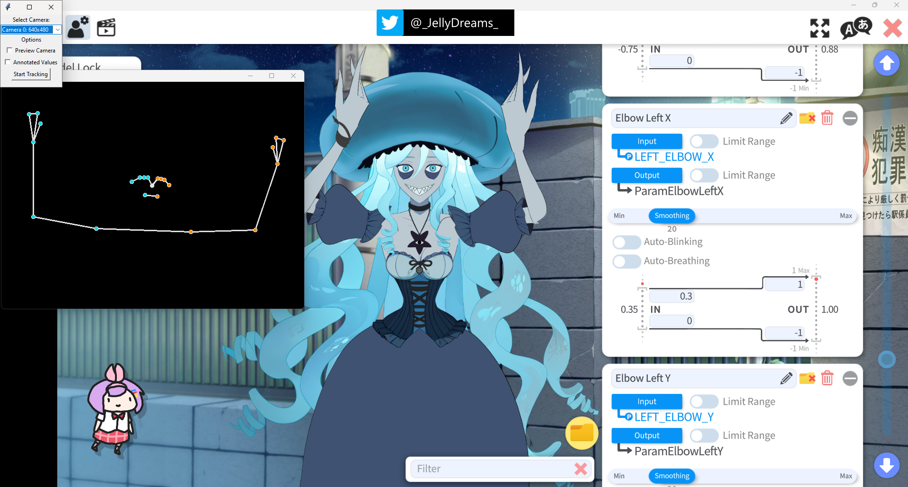
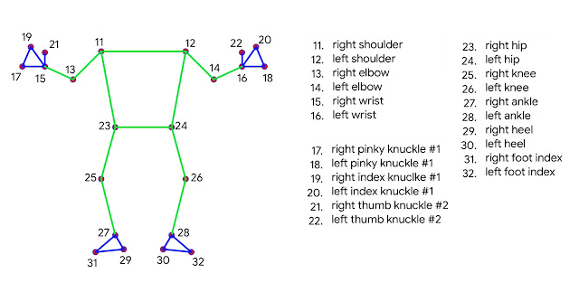

# VTS FULLBODY TRACKING

[discord-link]: https://discord.gg/9K9gejWQ3s
[![Last Release][github-release-badge]](https://github.com/jellydreams/VTS-Fullbody-Tracking/releases)
[![VTS FULLBODY TRACKING Discord][discord-badge]](https://discord.gg/9K9gejWQ3s)
[![Twitter Follow][twitter-badge]](https://twitter.com/_JellyDreams_)

🔗 website: [vts-fullbody-tracking.gitlab.io](https://vts-fullbody-tracking.gitlab.io/) 

[discord-badge]: https://img.shields.io/badge/Join_Discord-indigo?logo=discord&logoColor=white&color=7289da
[twitter-badge]: https://img.shields.io/twitter/follow/_JellyDreams_.svg?style=social
[github-release-badge]: https://img.shields.io/github/v/release/jellydreams/VTS-Fullbody-Tracking?label=Beta%20release

Full-body tracking for Live2D VTubers, using a camera.
- **Arms**: Shoulders, Elbow, Wrists
- **Torso**: Clavicles, Hips
- **Legs**: Knees, Ankles
- **Feet**: Heels, Feet Index
- **Hands**: Pinkies Knuckles, Index Knuckles, Thumb Knuckles

Plugin can be used with [VTube Studio](https://denchisoft.com/) or [Nizima LIVE](https://nizimalive.com/en/)

## Run the Plugin

**Requirements**: Window, VTube Studio or Nizima LIVE, Camera

1. **Download the executable** from the [releases page](https://github.com/jellydreams/VTS-Fullbody-Tracking/releases)
1. **Connect a camera**
1. **Double-click on the executable file** VTS_Fullbody_Tracking.exe to launch the plugin. A settings window will appear.
1. **Select your camera**. The camera should be different from the one used in Vtube Studio or Nizima LIVE.
1. **Open your software (VTube Studio or Nizima LIVE)** ['Start API' setting should be enabled in VTube Studio]
1. **Click on the 'Start Tracking'** button.
1. **Allow the plugin** in your software. A window displaying a preview of pose tracking will appear.
1. **Configure your model's parameter settings**, using plugin parameters as inputs.

📖 Wiki Section - [Run the plugin](https://github.com/jellydreams/VTS-Fullbody-Tracking/wiki/Run-the-plugin)

## Custom Parameters
Plugin add new parameters to control live2d model, each body part has parameters for controlling its position (X/Y/Z) and visibility.

📖Wiki Section - [List of Parameters](https://github.com/jellydreams/VTS-Fullbody-Tracking/wiki/Custom-Parameters)

